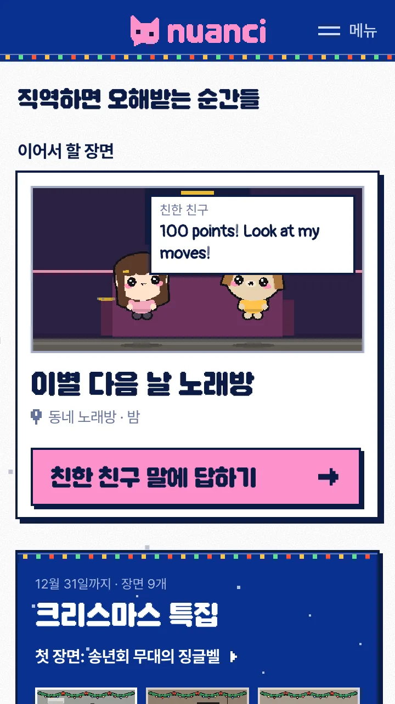
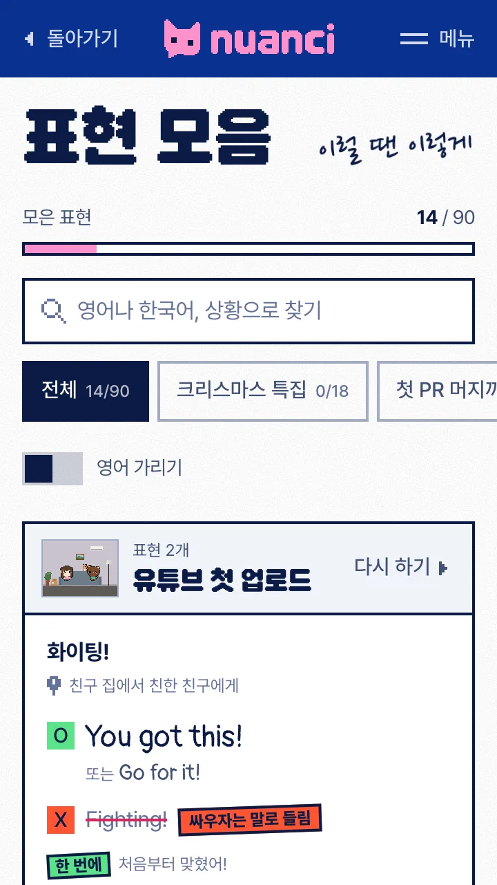
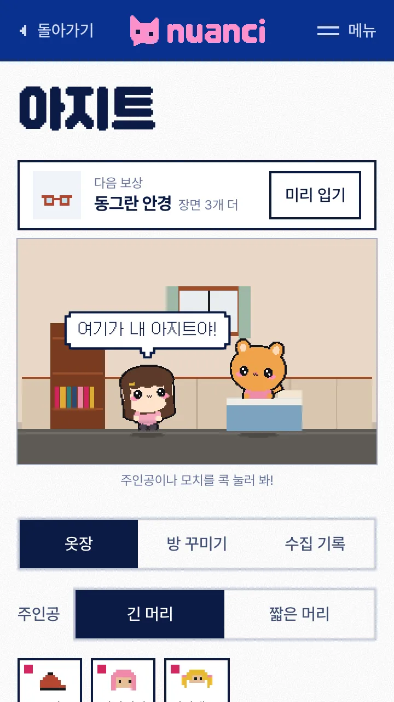
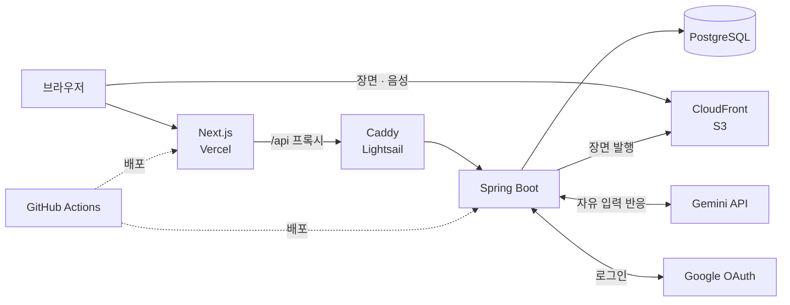

<div align="center">


외국어를 배운다는 건, 다른 방식으로 생각해 보는 일이에요.<br>
짧은 장면에서 영어 한마디를 고르면, 그 말이 상대에게 어떻게 들렸는지 바로 보여요.

<br>

**[바로 해 보기](https://nuanci.app)**

<sub>가입 없이 바로 · 한 장면에 1분</sub>

</div>

<br>

<div align="center">
  <h3>맞게 말했는데, 왜 다르게 들릴까?</h3>
  <p>첫 영상을 올리는 친구에게 힘내라고 했을 뿐인데, 친구는 "나 우울해 보여?"라고 되물어요.<br>단어도 문법도 틀리지 않았어요. 말에는 그 문화의 생각 습관이 담겨 있어서,<br>같은 마음도 영어에서는 다른 말로 건네야 할 때가 있어요.</p>
  <p>학교에서는 단어와 문법을 외웠지만, 그 말이 어떤 마음으로 들리는지는 배운 적이 없어요.<br>nuanci는 그 차이를 장면 속에서 직접 겪어 보게 해요.</p>
  
</div>

<br>

<div align="center">
  <h3>골라 보면 알아요</h3>
  <p>고른 말에 따라 상대의 표정과 속마음이 달라져요. 캐릭터 대사는 진짜 영어 목소리로 들려요.<br>왜 그렇게 들렸는지 보고, 다른 말도 눌러 보며 차이를 느껴 봐요.</p>
  
</div>

<br>

<div align="center">
  <h3>다음 장면 하나, 그리고 모음</h3>
  <p>홈에는 이어서 할 장면 하나만 크게 보여요.<br>친구랑·회사에서 같은 상황별 모음과 크리스마스 같은 특집도 골라 볼 수 있어요.</p>
  
  
</div>

<br>

<div align="center">
  <h3>세 장면마다 내 영어 말투</h3>
  <p>장면 셋을 끝내면 내 영어가 상대에게 어떻게 들리는 편인지 한 줄로 나와요.<br>마음과 다르게 들린 말을 모아 보고, 결과를 친구에게 보낼 수 있어요.</p>
  
</div>

<br>

<div align="center">
  <h3>표현 모음 · 아지트</h3>
  <p>만난 표현은 도감처럼 모여요. 처음부터 맞힌 표현엔 '한 번에' 도장이 찍혀요.<br>장면을 하며 얻은 물건으로 내 캐릭터와 방을 꾸며요.</p>
  
  
</div>

<br>

## 기술 스택

| | |
|---|---|
| **Frontend** | Next.js 16, React 19, TypeScript, Tailwind CSS v4, three.js, React Three Fiber |
| **Backend** | Kotlin, Spring Boot 4, Spring Data JPA, Flyway, Testcontainers |
| **Database** | PostgreSQL 17 |
| **AI · 음성** | Gemini API(자유 입력 반응), ElevenLabs(캐릭터 목소리) |
| **Infra** | Vercel, AWS Lightsail, S3 · CloudFront, Docker Compose, Caddy, GitHub Actions |

## 아키텍처



<details>
<summary><b>이렇게 만들었어요</b></summary>

<br>

- **픽셀 무대:** three.js 장면을 고정된 가로 픽셀 수로 그려서, 화면 크기가 달라도 도트 밀도가 같아요.
- **빠른 첫 화면:** 무대는 글자와 버튼이 뜬 뒤 따로 불러와요.
- **장면 관리:** 장면은 코드가 아니라 DB에 버전별로 저장해요. 새 장면은 초안으로 들어가고, 올리기 전 보기 자동 검사와 관리자 검수를 거쳐요.
- **장면 발행:** 공개한 장면은 내용 해시 주소의 정적 JSON으로 S3 · CloudFront에 올려, 서버가 멈춰도 장면을 읽을 수 있어요.
- **다음 장면:** 홈에는 이어서 할 장면 하나만 둬요. 특집 안이면 그 묶음의 다음, 아니면 추천 순서의 안 해 본 첫 장면이에요.
- **목소리:** 캐릭터마다 목소리를 디자인해 대사를 미리 만들어 두고, 장면 단계별 묶음 파일로 CDN에서 받아요. 음성이 없는 대사는 웅얼거림 소리로 대신해요.
- **효과음:** 실제 악기 사운드폰트로 만든 짧은 효과음을 Web Audio로 재생해요.
- **상황별 표현 페이지:** 표현마다 서버에서 글로 그린 공개 페이지(`/learn`)가 있어 검색에서도 찾을 수 있어요.
- **공유 카드:** 장면과 결과마다 Open Graph 이미지를 코드로 그려요.
- **지표:** 크롤러와 자동화 브라우저는 이용 지표에서 빼요.

</details>

<details>
<summary><b>프로젝트 구조</b></summary>

<br>

```text
.
├── frontend/src/
│   ├── app/                 # Next.js 라우트, 폰트, 전역 스타일
│   └── features/            # 기능별 코드
│       ├── scene/           # 장면 플레이
│       ├── stage/           # 픽셀 무대와 캐릭터
│       ├── landing/         # 홈, 데모, 장면 목록
│       ├── typetest/        # 유형 테스트
│       ├── collection/      # 표현 모음
│       ├── learn/           # 상황별 표현 공개 페이지
│       ├── avatar/          # 주인공 모습
│       ├── season/          # 특집 장식
│       ├── push/            # 웹 푸시
│       ├── review/          # 오늘의 복습
│       ├── rewards/         # 보상 물건
│       ├── account/         # 로그인, 내 정보, 아지트
│       ├── share/           # 공유 카드
│       └── site/            # 머리줄, 전체 메뉴, 화면 틀
├── backend/src/main/
│   ├── kotlin/com/nuanci/   # scene, account, reward, streak, review, event, metrics, admin ...
│   └── resources/db/migration/   # Flyway 마이그레이션
├── scripts/                 # 로컬 실행, 배포, 장면 업로드, 음성 생성, 보기 검사
├── compose.yaml             # 로컬 PostgreSQL
└── compose.prod.yaml        # 운영 서버 구성
```

</details>
