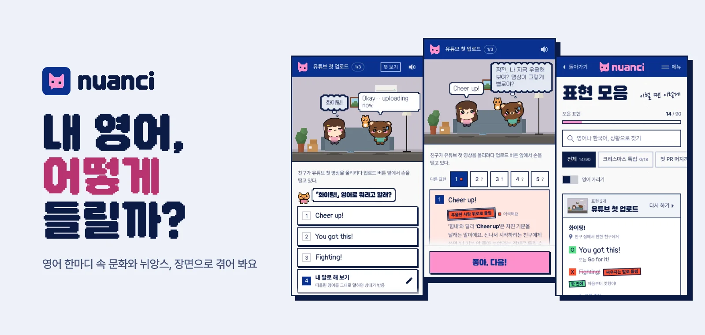
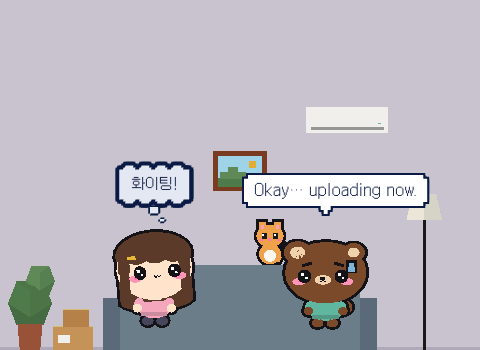
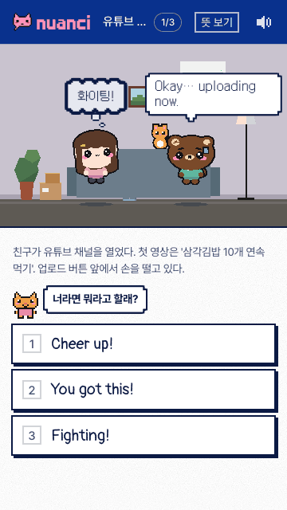
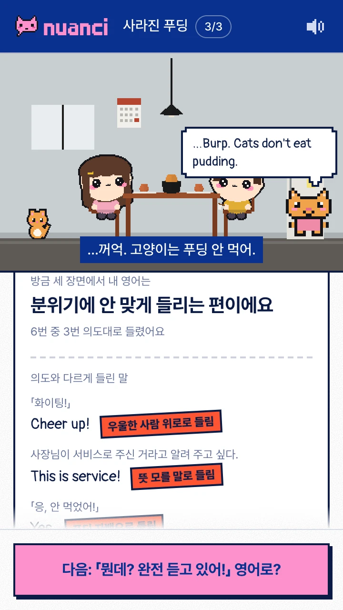
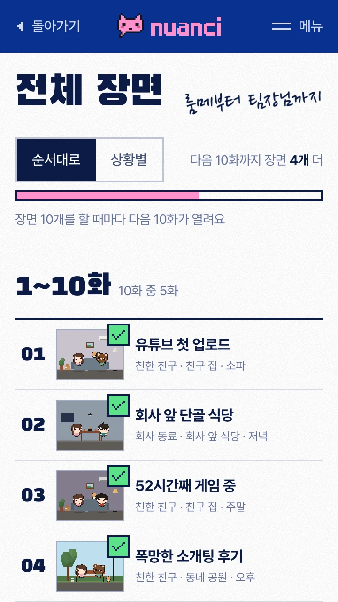
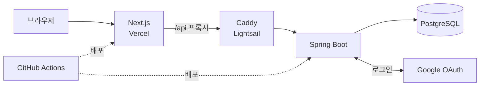

<div align="center">



짧은 장면을 보고 영어 한마디를 골라 보세요.<br>
고른 말에 따라 상대 반응이 달라져요.

<br>

**[바로 해 보기](https://nuanci.app)**

<sub>가입 없이 바로 · 한 장면에 1분</sub>

</div>

<br>

<div align="center">
  <h3>이 말, 영어로 통할까?</h3>
  <p>화이팅, 콘센트, 물은 셀프.<br>한국어 그대로 옮긴 말이 상대에게 어떻게 들리는지 무대 위에서 바로 보여요.</p>
  
</div>

<br>

<div align="center">
  <h3>골라 보면 알아요</h3>
  <p>고른 말에 따라 상대의 표정과 속마음이 달라져요.<br>왜 그렇게 들리는지 확인하고, 다른 말도 눌러 볼 수 있어요.</p>
  
</div>

<br>

<div align="center">
  <h3>세 장면마다 내 영어 말투</h3>
  <p>장면 셋을 끝내면 내 영어가 어떻게 들리는 편인지 한 줄로 나와요.<br>의도와 다르게 들린 말을 모아 보고, 결과를 친구에게 보낼 수 있어요.</p>
  
</div>

<br>

<div align="center">
  <h3>표현 모음 · 전체 장면 · 아지트</h3>
  <p>해 본 장면의 표현은 모아서 복습하고<br>장면을 하며 얻은 물건으로 내 캐릭터와 방을 꾸며요.</p>
  
  
  
</div>

<br>

## 기술 스택

| | |
|---|---|
| **Frontend** | Next.js 16, React 19, TypeScript, Tailwind CSS v4, three.js, React Three Fiber |
| **Backend** | Kotlin, Spring Boot 4, Spring Data JPA, Flyway, Testcontainers |
| **Database** | PostgreSQL 17 |
| **Infra** | Vercel, AWS Lightsail, Docker Compose, Caddy, GitHub Actions |

## 아키텍처



<details>
<summary><b>이렇게 만들었어요</b></summary>

<br>

- **픽셀 무대:** three.js 장면을 고정된 가로 픽셀 수로 그려서, 화면 크기가 달라도 도트 밀도가 같아요.
- **빠른 첫 화면:** 무대는 글자와 버튼이 뜬 뒤 따로 불러와요.
- **장면 관리:** 장면은 코드가 아니라 DB에 버전별로 저장해요. 새 장면은 초안으로 들어가고 관리자 화면에서 검수해요.
- **연속 장면:** 다음 장면은 전체 장면 순서를 그대로 따라가요. 예고 문구와 묶음은 장면 데이터로 정해요.
- **효과음:** 음원 파일 없이 Web Audio로 그때그때 만들어요.
- **공유 카드:** 장면과 결과마다 Open Graph 이미지를 코드로 그려요.
- **지표:** 크롤러와 자동화 브라우저는 이용 지표에서 빼요.

</details>

<details>
<summary><b>프로젝트 구조</b></summary>

<br>

```text
.
├── frontend/src/
│   ├── app/                 # Next.js 라우트, 폰트, 전역 스타일
│   └── features/            # 기능별 코드
│       ├── scene/           # 장면 플레이
│       ├── stage/           # 픽셀 무대와 캐릭터
│       ├── landing/         # 홈, 데모, 장면 목록
│       ├── typetest/        # 유형 테스트
│       ├── collection/      # 표현 모음
│       ├── review/          # 오늘의 복습
│       ├── rewards/         # 보상 물건
│       ├── account/         # 로그인, 내 정보, 아지트
│       ├── share/           # 공유 카드
│       └── site/            # 머리줄, 전체 메뉴, 화면 틀
├── backend/src/main/
│   ├── kotlin/com/nuanci/   # scene, account, reward, streak, review, event, metrics, admin ...
│   └── resources/db/migration/   # Flyway 마이그레이션
├── scripts/                 # 로컬 실행, 배포, 장면 업로드
├── compose.yaml             # 로컬 PostgreSQL
└── compose.prod.yaml        # 운영 서버 구성
```

</details>
